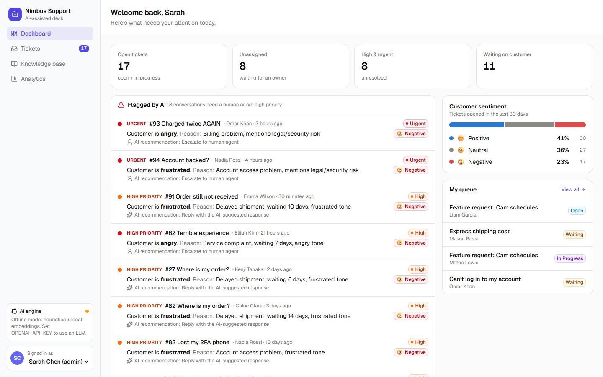
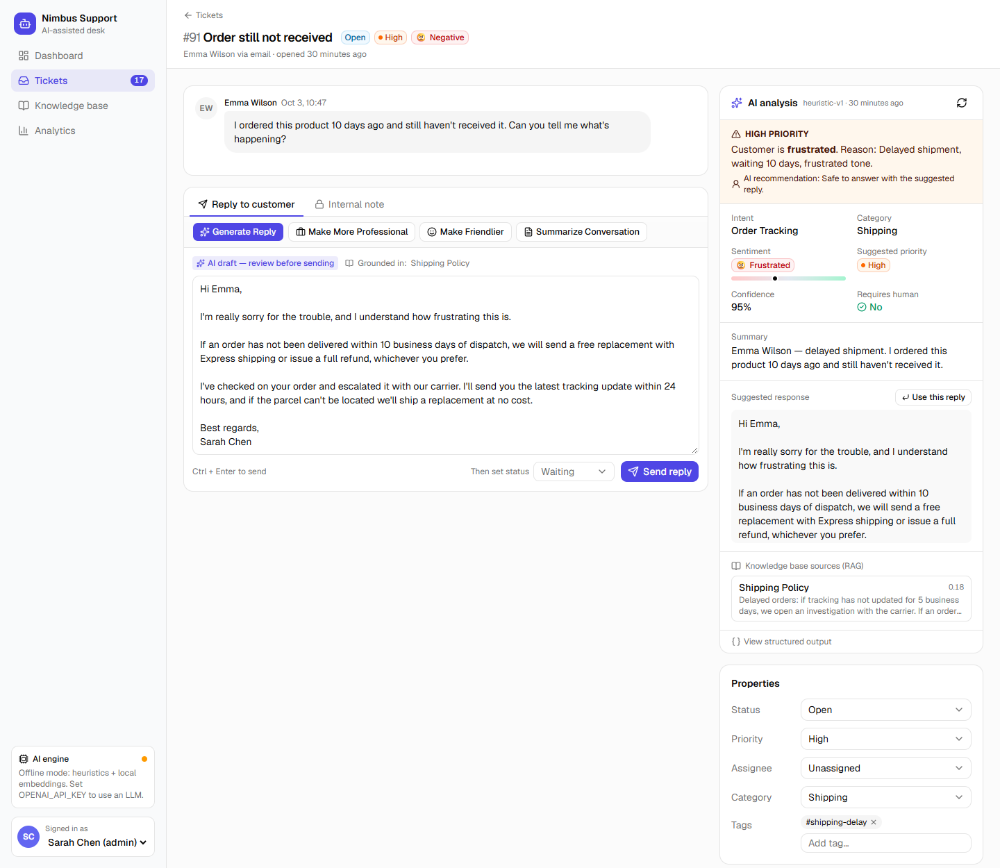
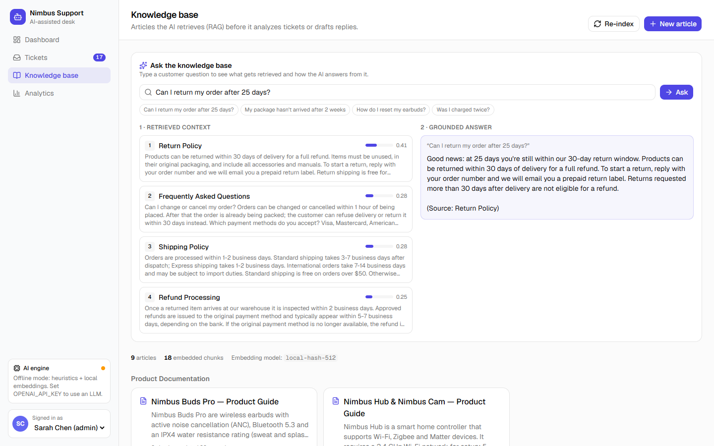
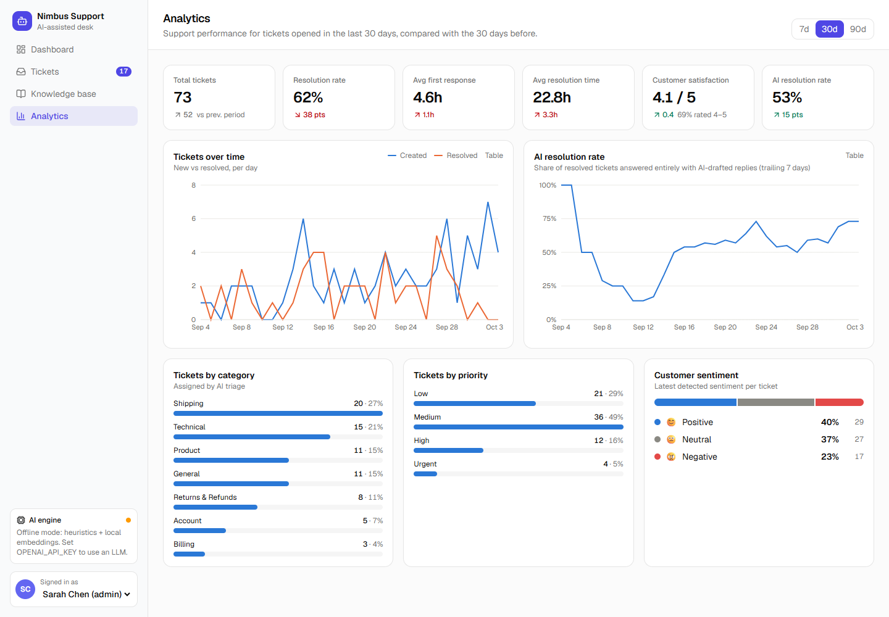
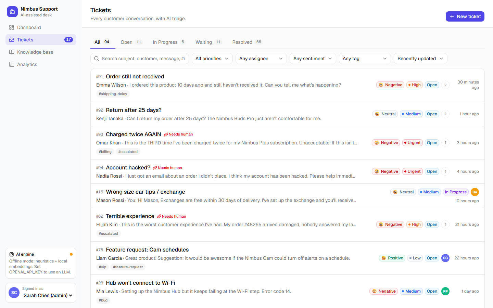

# Nimbus Support Desk — AI-assisted customer support dashboard

A full-stack support desk where an AI triages every conversation, retrieves policy from a knowledge base (RAG), and drafts replies that a human agent reviews before sending.

**Stack:** Next.js 16 (App Router, Server Actions) · TypeScript · Tailwind CSS v4 · shadcn/ui · Recharts · Prisma · SQLite · OpenAI (optional) · Vitest · GitHub Actions



## Screenshots

**Ticket view with the AI assistant** — structured analysis, KB sources, and an AI-drafted reply the agent reviews before sending.



**Knowledge base RAG playground** — what the vector search retrieved, side by side with the grounded answer.



**Analytics**



**Ticket queue** with search, filters, sentiment and priority.



## Quick start

```bash
git clone https://github.com/Script-Demon/AI-Customer-Support.git
cd AI-Customer-Support
npm install
npm run setup      # creates prisma/dev.db and seeds demo data
npm run dev        # http://localhost:3000
```

No API key needed: without `OPENAI_API_KEY` the app runs in **offline mode** (heuristic classifier + local hashing embeddings). To use an LLM, set it in `.env`:

```env
OPENAI_API_KEY="sk-..."
OPENAI_MODEL="gpt-4o-mini"                     # any chat model that supports Structured Outputs
OPENAI_EMBEDDING_MODEL="text-embedding-3-small"
```

The knowledge base re-embeds itself automatically the first time it's searched with a different embedding model. Seeding always uses offline analysis, so it never costs API credits.

## Features

| Area | What's there |
|---|---|
| 🎫 Tickets | Create, assign, status workflow (Open → In Progress → Waiting → Resolved), priority, category, tags, internal notes, replies, search + filters (status, priority, assignee, sentiment, tag), activity log, CSAT |
| 🤖 AI analysis | Structured JSON per conversation: `intent`, `sentiment`, `emotion`, `priority`, `category`, `confidence`, `requires_human`, `reason`, `summary`, `suggested_response`. Re-runs automatically when the customer writes again; escalates priority when needed |
| 🧠 Knowledge base / RAG | Articles are chunked on paragraph boundaries, embedded, and searched by cosine similarity. Retrieved excerpts are injected into every analysis and draft, and shown as cited sources. A playground shows retrieval scores next to the grounded answer |
| 😊 Sentiment | Positive / neutral / negative split, per-ticket emotion, and a "Flagged by AI" feed with reason + recommendation |
| ✍️ Reply assistant | Generate Reply · Make More Professional · Make Friendlier · Summarize Conversation. Drafts are always reviewed by the agent; AI-assisted replies are tracked |
| 📊 Analytics | Total tickets, resolution rate, avg first response, avg resolution time, CSAT, AI resolution rate (with period-over-period deltas), tickets over time, AI resolution rate trend, by category, by priority, sentiment |

**Demo tip:** open a ticket and use **Simulate customer reply** (bottom right) to play the customer and watch the AI re-triage the ticket live.

## Architecture

```
src/
  app/                      pages (dashboard, tickets, knowledge, analytics) + actions.ts (all mutations)
  lib/ai/
    client.ts               OpenAI client, Structured Outputs helper
    embeddings.ts           OpenAI embeddings or local feature-hashing fallback, cosine similarity
    rag.ts                  chunking, indexing, vector search
    analyze.ts              ticket analysis (retrieve → classify + draft → persist)
    compose.ts              reply generation, tone rewrite, summaries, KB Q&A
    heuristics.ts           offline fallbacks for every AI feature (pure, unit-tested)
  lib/analytics.ts          metric computation
prisma/                     schema, seed, knowledge base content
tests/                      Vitest unit tests for the AI layer
```

Design choices worth knowing:

- **AI assists, humans send.** Nothing is sent to a customer without an agent clicking Send. "AI resolution rate" counts resolved tickets whose every public reply came from an AI draft.
- **Graceful degradation.** Every LLM call has a deterministic offline fallback, also used if the API errors.
- **Grounded output.** Prompts restrict the model to retrieved excerpts; the offline path applies simple policy checks (e.g. "25 days vs a 30-day window").
- **Vector search in app code.** Fine for hundreds of chunks. For production scale, switch the datasource to PostgreSQL and move embeddings to `pgvector`.

## Scripts

| Script | Does |
|---|---|
| `npm run dev` / `build` / `start` | Next.js |
| `npm run setup` | Create the DB schema and seed |
| `npm run db:seed` | Re-seed (clears all data) |
| `npm test` | Vitest unit tests |
| `npm run lint` / `typecheck` | ESLint / tsc |

There's no authentication: the "signed in" agent is chosen in the sidebar switcher.

## License

[MIT](LICENSE)
